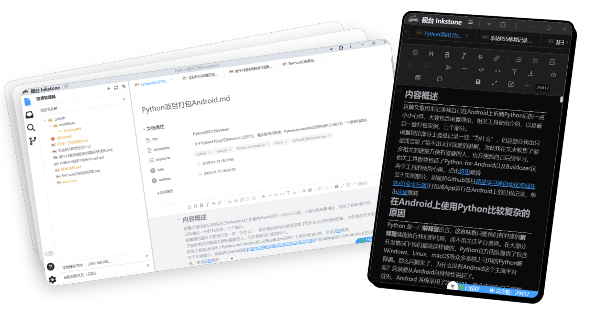

    
    

    
    
    
    
    
    
    

<h1 style="text-align: center;">Para más documentación, visita el sitio oficial: <a href="https://inkstone.work" target="_blank">https://inkstone.work</a></h1>

# 砚台/InkStone

## 💡 Introducción

**InkStone** es un editor de Markdown desarrollado con Vue. Aunque es un proyecto nuevo y muchas funciones aún están en proceso de mejora, gracias a los editores `Vditor` y `Codemirror`, InkStone ofrece una experiencia de Markdown fiable y cómoda, además de permitir tareas ligeras de edición y navegación de código. Al basarse en los estándares web más recientes, InkStone proporciona una experiencia comparable a las aplicaciones nativas siendo una aplicación web puramente frontal, lo que facilita su despliegue y permite su uso en cualquier plataforma de dispositivo.

    <a href="docs/screenshots.md">@Más capturas de pantalla</a>

### Enlaces de Experiencia

[Versión Estable https://app.inkstone.work](https://app.inkstone.work)

[Versión de Desarrollo https://dev.inkstone.work](https://dev.inkstone.work)

> La versión de desarrollo se utiliza para probar las funciones más recientes; no se garantiza su estabilidad.
> 
> La versión de desarrollo actual permite cargar temas externos ([Ejemplo de tema Gruvbox](https://github.com/2061360308/inkstone-theme-gruvbox/)).
> 
> La función de cambio de repositorio en los ajustes de la versión de desarrollo actual ha sido eliminada.

## ✨ Características

| Característica                                                                                                                            | InkStone        | Typora          | Visual Studio Code (VSCode)   |
| ------------------------------------------------------------------------------------------------------------------------------- | --------------- | --------------- | ----------------------------- |
| **Función Principal**                                                                                                            | Editor Markdown   | Editor Markdown | Editor de código general, soporta Markdown |
| **Modo de Renderizado Instantáneo**                                                                                                    | ✔️              | ✔️              | Soporte mediante plugins        |
| **Modo WYSIWYG**                                                                                                                | ✔️              | ✔️              | Soporte mediante plugins        |
| **Modo de Vista Dividida**                                                                                                             | ✔️              | ✔️              | Soporte mediante plugins        |
| **Gestión de Archivos**                                                                                                                 | ✔️              | ✔️              | ✔️                            |
| Esquemas, fórmulas matemáticas, mapas mentales, gráficos, diagramas de flujo, Gantt, secuencia, partituras, multimedia, lectura de voz, anclas de título, resaltado y copia de código, renderizado de graphviz y PlantUML | ✔️              | ✔️              | Soporte mediante plugins        |
| **Soporte de Plugins**                                                                                                                  | ❌              | ✔️              | ✔️                            |
| **Temas y Estilos**                                                                                                                    | Próximamente     | ✔️              | ✔️                            |
| **Resaltado de Sintaxis**                                                                                                               | ✔️              | ✔️              | ✔️                            |
| **Atajos de Teclado**                                                                                                                  | ✔️              | ❌              | ✔️                            |
| **Atajos Personalizables**                                                                                                             | Próximamente     | ✔️              | ✔️                            |
| **Soporte de Multi-pestañas**                                                                                                          | ✔️              | ✔️              | ✔️                            |
| **Soporte Multiplataforma**                                                                                                            | PC + Móvil      | Solo PC         | Solo PC                        |
| **Integración con Github**                                                                                                             | ✔️              | ❌              | ✔️                            |
| **Tamaño**                                                                                                                             | Ultra ligero     | Ligero          | Grande                         |
| **Edición de Código**                                                                                                                   | ✔️              | ❌              | ✔️                            |
| **Costo**                                                                                                                               | Código abierto gratuito | ❌              | Código abierto gratuito        |
| **Alojamiento de Imágenes (Image Bed)**                                                                                                 | Gestión integrada | ✔️              | Soporte mediante plugins       |
| **Edición Visual de Yaml Front Matter**                                                                                                 | ✔️              | ❌              | ❌                            |

## Escenarios de Uso

1. Como editor de Markdown local tras instalar la PWA.
2. Como editor de código en línea para ediciones rápidas en repositorios de GitHub (similar a dev.github.com).
3. Complemento para la edición de Markdown en dispositivos móviles.
4. Como backend de edición para blogs estáticos personales.

## ✅ Hoja de Ruta / Tareas Previstas

- [x] Migración y organización del código de iconos.
- [x] Actualización de la estrategia de pull/push de archivos en GitHub.
- [x] Optimización del gestor de archivos (apariencia y funcionalidad).
- [ ] Unificación de temas y soporte para cambio de tema.
- [x] Permitir cargar/guardar configuración global.
- [x] Añadir funcionalidad de procesamiento de cadenas de formato al editor.
- [x] Mejora del bus de eventos.
- [x] Funciones más completas en la barra de estado inferior.
- [x] Más métodos de inicio de sesión, registro como GitHub App.
- [x] Lista de esquemas (Outline).
- [x] Lista de búsqueda.
- [x] Panel de ajustes más completo con más opciones configurables.
- [x] Desarrollo de alojamiento de imágenes.
- [x] Adaptación de los modos `history` y `hash`.
- [ ] Proxy personalizado para la API de GitHub.
- [x] Refactorización de estilos CSS, cambio a sintaxis Sass y soporte de modo oscuro.
- [x] Refactorización del código de componentes para separar partes mezcladas.
- [x] Implementación de importaciones bajo demanda y empaquetado por fragmentos para optimizar la carga.
- [ ] Funciones de gestión de imágenes más prácticas.
- [ ] Capacidad de procesamiento local de imágenes mediante Wasm.
- [x] Optimización de PWA para acercarse a las funciones de un editor local.
- [x] Mejora de las funciones existentes del editor Codemirror.
- [x] Corrección del bug de pantalla completa del editor.
- [ ] Hacer que la edición visual de Front Matter sea opcional.
- [ ] Corregir el flujo de inicio de sesión con Token personal.

> Si tienes nuevas necesidades o urgencia por alguna de estas funciones, puedes proponerlo en los issues.

## Obtener Capacidades Avanzadas

**InkStone** es una aplicación web progresiva (PWA). Puedes instalarla para obtener una experiencia más fluida:
1. Barra de título similar a una aplicación nativa.
2. Configurarla como la aplicación predeterminada del sistema para abrir archivos Markdown.
3. Uso completamente offline (los datos se almacenan en caché y funcionan sin internet).

## 🛠️ Desarrollo / Autodespliegue

**InkStone** es una aplicación puramente frontal sin contenido de backend, por lo que los requisitos de despliegue son muy bajos. Si tienes un servidor, simplemente copia el contenido empaquetado; solo requiere 8MB de espacio de almacenamiento. Si no tienes uno, también puedes desplegarlo en GitHub Pages, COS, Vercel, entre otras plataformas.

Pasos para empaquetar y ejecutar por cuenta propia (pasos genéricos para proyectos Vite):

1. Clonar el proyecto localmente.
2. Instalar las dependencias usando `pnpm install`.
3. Ejecutar o empaquetar con `pnpm run dev / pnpm build`.

## 📄 Licencia

InkStone utiliza la licencia de código abierto MIT.

## 🙏 Agradecimientos

**Vditor**：Un editor de Markdown basado en navegador que soporta WYSIWYG, renderizado instantáneo (similar a Typora) y modo de vista dividida. Implementado en TypeScript, compatible con JavaScript nativo y frameworks como Vue, React, Angular y Svelte.

**Vue**：Vue (pronunciado /vjuː/, como view) is a progressive framework for building user interfaces.

**Lute**：🎼 Un motor de Markdown estructurado que soporta Go y JavaScript.

**highlight.js**：JavaScript syntax highlighter.

**mermaid**：Generation of diagram and flowchart from text in a similar manner as Markdown.

**incubator-echarts**：A powerful, interactive charting and visualization library for browser.

**abcjs**：JavaScript library for rendering standard music notation in a browser.
